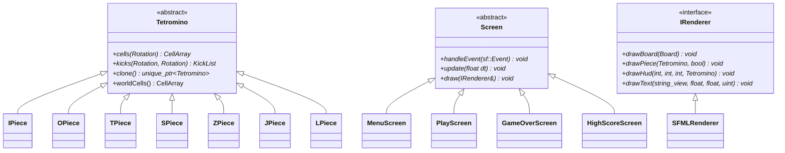

# TetroForge: Version 1.0

A complete Tetris-style puzzle game in C++17 built with a modular layered architecture and SFML frontend.

**Prepared by:** Kapil Yadav (Roll No. 25/CS/191, Section A3)  
**Programme:** B.Tech CSE, Delhi Technological University (DTU)  
**Course:** Object-Oriented Programming (CS203), Semester 3 | October 2026  
**Structure:** IEEE 830 / ISO/IEC/IEEE 29148  

---

## 1. Overview & Architecture

TetroForge is built around a clean, decoupled architecture divided into two primary tiers:

```
+------------------------------------------------------------------------+
| Presentation (SFML)                                                    |
|  - Application (Window & Screen Manager)                               |
|  - Screens: MenuScreen, PlayScreen, GameOverScreen, HighScoreScreen    |
|  - IRenderer & SFMLRenderer (Hardware-accelerated & Pixel Fallback)    |
|  - SoundPlayer (Synthesized 16-bit PCM Audio Effects)                  |
|  - InputHandler (Event to Action mapping)                              |
+------------------------------------------------------------------------+
                                  |
                                  v
+------------------------------------------------------------------------+
| Core (Pure C++17, Headless, Independent of SFML)                       |
|  - Game (Gameplay orchestration, Gravity, Scoring, Levels, State)      |
|  - Board (10x20 playfield + 20 hidden rows, SRS wall kicks, clearing)  |
|  - Tetromino + 7 concrete shapes (I, O, T, S, Z, J, L)                 |
|  - PieceFactory (Factory Method pattern)                               |
|  - ScoreManager (Top 5 scores, highscores.txt persistence)             |
|  - Vec2i & Grid<T> (Math primitives & bounds-checked container)        |
+------------------------------------------------------------------------+
```

### Layering Rules
1. **Core** is pure C++17 and never includes graphics/audio headers (`SFML`, audio libraries, or third-party frameworks). Core logic is headless and fully testable in console mode without a window.
2. **Presentation** depends on Core and handles SFML rendering, screens, sound effects, and user interaction.

---

## 2. Object-Oriented Design & Principles

| Concept | Implementation Details |
| --- | --- |
| **Encapsulation** | `Board` keeps its internal cell grid private; `Game` encapsulates state, RNG, gravity counters and exposes read-only getters; `ScoreManager` protects score entries. |
| **Abstraction** | `Tetromino` abstract base for pieces; `Screen` abstract base for UI screens; `IRenderer` interface for graphics rendering. |
| **Inheritance** | 7 piece subclasses (`IPiece`, `OPiece`, `TPiece`, `SPiece`, `ZPiece`, `JPiece`, `LPiece`); 4 screen subclasses (`MenuScreen`, `PlayScreen`, `GameOverScreen`, `HighScoreScreen`); `SFMLRenderer` implementing `IRenderer`. |
| **Runtime Polymorphism** | Virtual `cells()` and `kicks()` on `Tetromino`; virtual `handleEvent()`, `update()`, and `draw()` on `Screen`; virtual draw calls on `IRenderer`. |
| **Composition** | `Game` owns a `Board` and `Tetromino` pieces; `Application` owns `sf::RenderWindow`, `IRenderer`, and `Screen`. |
| **Factory Pattern** | `PieceFactory::create(PieceType)` returns `std::unique_ptr<Tetromino>`. |
| **Prototype Pattern** | `Tetromino::clone()` produces deep copies for ghost piece projections. |
| **Operator Overloading** | `Vec2i` overloaded `+`, `-`, unary `-`, `==`, `!=`, and stream `<<`. |
| **Exception Handling** | `ScoreFileError` derived from `std::runtime_error` handles corrupt file data gracefully. |
| **Smart Pointers** | `std::unique_ptr` used throughout for memory safety with zero raw owning pointers. |
| **Robust File I/O** | `highscores.txt` persistent storage with automated validation and fallback. |

### Class Hierarchies



---

## 3. Game Controls
 
| Action | Primary Key | Secondary / Mouse |
| --- | --- | --- |
| **Move Left / Right** | Left / Right Arrow | - |
| **Rotate Clockwise** | Up Arrow | X |
| **Rotate Counter-Clockwise** | Z | Left Control |
| **Hold Piece** | C | Left Shift |
| **Soft Drop** | Down Arrow | - |
| **Hard Drop** | Spacebar | - |
| **Pause / Resume** | P or Escape | - |
| **Restart Game** | R (when paused or Game Over) | - |
| **Menu Navigation** | Up / Down Arrows + Enter | Left Mouse Click / Hover |
| **Return to Menu** | M or Escape | Mouse Click |
 
---
 
## 4. Gameplay Rules & Scoring
 
- **Playfield:** 10 columns by 20 visible rows (plus 20 hidden spawn rows).
- **7-Bag Randomizer:** Guarantees all 7 tetromino shapes (I, O, T, S, Z, J, L) appear in every 7-piece cycle before repeats.
- **Hold Queue:** Swap the falling piece into the hold slot with `C` or `Shift` (limited to 1 hold per locked piece).
- **Spawn & Preview:** Tetrominoes spawn at top-center; next piece and held piece previews are displayed in the HUD.
- **SRS Wall Kicks:** Full Super Rotation System (SRS) kick tables for all pieces in both clockwise and counter-clockwise directions.
- **Ghost Piece:** Real-time preview showing where the active piece will land.
- **Scoring:**
  - 1 Line Clear: `100 * level`
  - 2 Line Clears: `300 * level`
  - 3 Line Clears: `500 * level`
  - 4 Line Clears (Tetris): `800 * level`
  - Soft Drop: `1 point per cell`
  - Hard Drop: `2 points per cell`
- **Level Progression:** Level advances every 10 lines cleared (`level = lines / 10 + 1`).
- **Gravity Interval:** `interval_ms = max(100, 1000 - 90 * (level - 1))`
- **High Scores:** Top 5 scores persisted to `highscores.txt`.

---

## 5. Building and Running

### Prerequisites
- C++17 compliant compiler (GCC 9+, Clang 10+, or MSVC 2019+)
- CMake 3.20 or newer
- SFML 2.5+ (`libsfml-dev` on Linux)
- Catch2 v3 (automatically fetched via CMake FetchContent if not installed)

### Linux
```bash
# Configure, build and run tests using presets
cmake --preset debug
cmake --build --preset debug
ctest --preset debug

# Run the game
./build/debug/src/tetroforge
```

### Windows (Developer PowerShell / MSVC)
```powershell
cmake -S . -B build
cmake --build build --config Release
ctest --test-dir build -C Release --output-on-failure

# Run the game
.\build\src\Release\tetroforge.exe
```

### Packaging Distribution Zip
To package only the files necessary to build and run the game along with `README.md`:
```bash
python3 package_project.py
# Or: ./package.sh
```

---

## 6. Verification and Test Cases (SRS §7.2)

| Test ID | Requirement | Scenario | Result |
| --- | --- | --- | --- |
| **TC-01** | FR-1.5 | Rotate I piece against right wall kicks or rejects without leaving board | Passed |
| **TC-02** | FR-1.9 | Fill 9 columns of 4 rows, lock vertical I, clears all 4 rows and shifts down | Passed |
| **TC-03** | FR-2.1 | Clear 4 rows at level 2 increases score by 1600 | Passed |
| **TC-04** | FR-1.6, FR-2.2 | Hard drop lands at ghost position and scores 2 points per cell | Passed |
| **TC-05** | FR-1.10 | Spawn piece onto filled top area triggers GameOver state | Passed |
| **TC-06** | FR-2.3, FR-2.4 | Clear 10 lines reaches level 2 with fall interval 910 ms | Passed |
| **TC-07** | FR-4.2 | Load corrupt highscores.txt leaves empty list without crashing | Passed |
| **TC-08** | FR-1.11 | Pausing game halts gravity tick and piece movement | Passed |
| **7-Bag** | SRS §10 | 7-bag randomizer yields all 7 unique pieces in every 7-piece cycle | Passed |
| **Rotate-CCW** | SRS §10 | Counter-clockwise rotation cycles through SRS orientations | Passed |
| **Hold-Piece** | SRS §10 | Hold piece stores active, swaps, blocks reuse, and resets on lock | Passed |
| **Layering** | NFR-4 | Enforces Core has no forbidden includes or non-deterministic calls | Passed |
